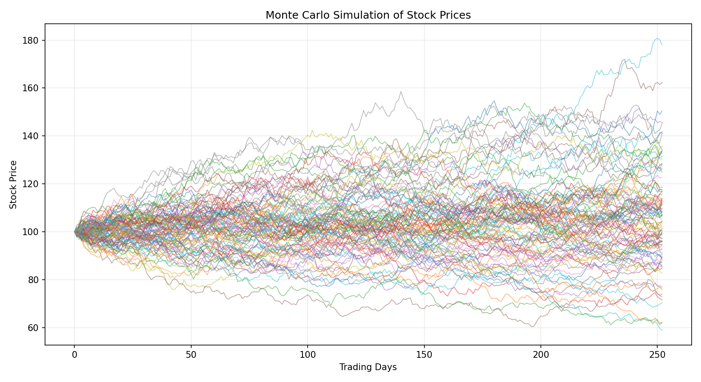
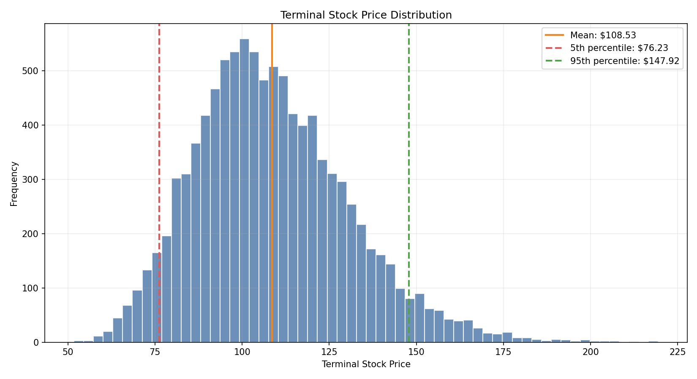

# Monte Carlo Quantitative Risk & Derivatives Engine

[Live simulator](https://neil-314.github.io/Monte-Carlo-Engine/) | [Source code](https://github.com/neil-314/Monte-Carlo-Engine)

A Python-based quantitative finance project for simulating equity prices, pricing European options, and analyzing portfolio risk using Monte Carlo methods.

This project is intentionally built without live market data. The inputs are hard-coded so the model assumptions, formulas, and outputs are easy to inspect and explain.

## Overview

The engine uses Monte Carlo simulation to model uncertain future stock prices, estimate European option values, validate those estimates against the Black-Scholes analytical model, and simulate a correlated multi-asset portfolio. It includes both a Python analysis engine and a static browser simulator served through GitHub Pages.

## Features

- Geometric Brownian Motion stock-price simulation
- 10,000+ single-stock price paths
- Terminal price statistics and distribution analysis
- European call and put option pricing
- Black-Scholes analytical validation
- Monte Carlo convergence analysis
- Multi-asset portfolio simulation
- Correlated asset returns using Cholesky decomposition
- Value at Risk and CVaR / Expected Shortfall
- Portfolio loss probability and return distribution
- Dark-mode browser simulator in `docs/index.html`
- Basic automated tests
- Jupyter notebook for interactive analysis

## Project Structure

```text
monte-carlo-engine/
|-- README.md
|-- requirements.txt
|-- main.py
|-- docs/
|   |-- index.html
|   `-- .nojekyll
|-- src/
|   |-- __init__.py
|   |-- simulation.py
|   |-- option_pricing.py
|   |-- portfolio.py
|   |-- risk_metrics.py
|   `-- run_analysis.py
|-- notebooks/
|   `-- analysis.ipynb
|-- tests/
|   |-- conftest.py
|   `-- test_models.py
|-- results/
|   |-- stock_paths.png
|   |-- terminal_distribution.png
|   |-- option_convergence.png
|   `-- portfolio_distribution.png
```

## Installation

On Windows, if `python` opens the Microsoft Store, use the Python launcher:

```powershell
py -3.10 -m venv .venv
.\.venv\Scripts\python.exe -m pip install -r requirements.txt
```

On macOS or Linux:

```bash
python -m venv .venv
source .venv/bin/activate
pip install -r requirements.txt
```

## Usage

Generate all reports and charts:

```powershell
.\.venv\Scripts\python.exe main.py
```

Run individual modules:

```powershell
.\.venv\Scripts\python.exe src\simulation.py
.\.venv\Scripts\python.exe src\option_pricing.py
.\.venv\Scripts\python.exe src\portfolio.py
```

Open the local browser simulator:

```powershell
start docs\index.html
```

Run tests:

```powershell
.\.venv\Scripts\python.exe -m pytest
```

Open the notebook:

```powershell
.\.venv\Scripts\jupyter.exe notebook notebooks\analysis.ipynb
```

## Live Simulator

The interactive simulator lives in `docs/index.html`.

The live simulator is published from the `gh-pages` branch:

```text
https://neil-314.github.io/Monte-Carlo-Engine/
```

If the link returns `404`, check these repository settings:

1. Open the repository settings.
2. Go to Pages.
3. Set the source to `Deploy from a branch`.
4. Choose branch `gh-pages` and folder `/root`.
5. Save and wait a minute or two.

For a public LinkedIn demo, the GitHub repository should also be public.


## Methodology

### Geometric Brownian Motion

Stock paths are simulated with:

```text
dS = mu S dt + sigma S dW
```

In practical terms, `mu` controls expected growth, `sigma` controls volatility, `dt` is the time step, and `dW` is a random shock. The implementation uses the lognormal GBM solution so simulated stock prices remain positive.

### Monte Carlo Option Pricing

European options are priced by simulating terminal stock prices under the risk-neutral drift `r`, calculating option payoffs, averaging those payoffs, and discounting the result back to today.

```text
Call payoff = max(S(T) - K, 0)
Put payoff  = max(K - S(T), 0)
```

### Black-Scholes Validation

The project compares Monte Carlo prices against the analytical Black-Scholes formula. As the number of simulations increases, the Monte Carlo estimate generally converges toward the Black-Scholes price.

### Correlated Portfolio Simulation

Portfolio assets are not treated as independent. The simulation uses a correlation matrix and Cholesky decomposition to transform independent random shocks into correlated shocks before generating asset returns.

### VaR and CVaR

Value at Risk estimates a lower-tail loss threshold. CVaR, also called Expected Shortfall, estimates the average result within that lower tail.

## Results

### Stock Price Paths



### Terminal Price Distribution



Example output:

```text
MONTE CARLO RESULTS

Starting Price:          $100.00
Expected Terminal Price: $108.53
Median Terminal Price:   $106.27
Terminal Std. Dev.:      $21.99

5th Percentile:          $76.23
95th Percentile:         $147.92

Probability of Loss:      38.03%
Probability S(T) > $120: 27.74%
```

### Option Pricing

```text
EUROPEAN OPTION PRICING

Stock Price: $100.00
Strike:      $105.00
Expiration:  1 year
Volatility:  20%
Risk-Free:   4%
Scenarios:   100,000

Monte Carlo Call:    $7.53
Black-Scholes Call:  $7.57
Call Abs. Diff.:     $0.04
Call % Error:         0.50%

Monte Carlo Put:     $8.46
Black-Scholes Put:   $8.45
Put Abs. Diff.:      $0.01
